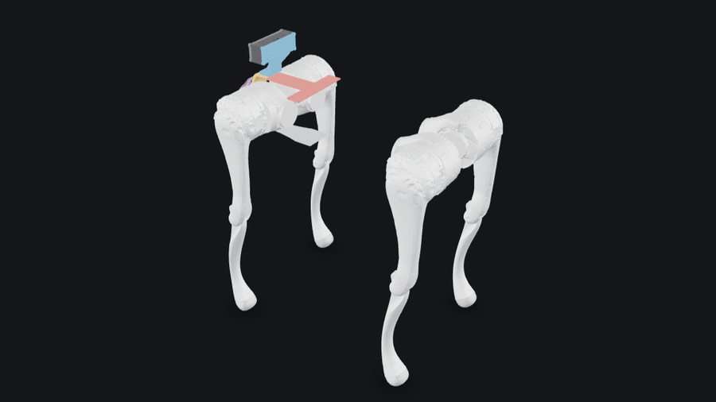

# Go2 深度相机与雷达安装模型

Unitree Go2（无 base 壳版本）顶部传感器的安装设计：**D435i 深度相机（带分体保护壳）** + **雷达安装连接链**，随附 Go2 四腿参考模型。使用 SolidWorks 2025 打开主装配：

**[SW_Ready/装配体/无头Go2传感器安装总装.SLDASM](SW_Ready/装配体/无头Go2传感器安装总装.SLDASM)**（22个原有顶层组件＋1个不计入BOM的电机运动包络参考，引用均在项目目录内）

相机深度图光学原点在 Go2 基坐标下为 **(22, 0, 10) cm**。复现安装请阅读[安装坐标与定位指南](SW_Ready/说明资料/安装坐标与定位指南.md)。

## 🎮 可交互 3D 总装预览

[](https://wang-xi683.github.io/go2_hardware_design/web3d/viewer.html)

**[👉 点图片或此链接打开 3D 查看器](https://wang-xi683.github.io/go2_hardware_design/web3d/viewer.html)** —— 打开后模型**静止不动**，按住鼠标左键拖动即可旋转，滚轮缩放、右键平移；右上角可切换"完整总装 / 传感器安装部分"，需要自动旋转时点"自动旋转：开"。手机可点 AR 放进真实场景。

（GitHub 的 README 只能显示静态图片，无法在页面内拖动 3D；拖动交互在查看器中进行。）

查看器由总装导出的 glTF 构建，每个组件保留装配坐标与独立配色：橙=圆弧中间连接件、蓝=相机支架与后盖一体件、红=雷达延长板、紫=雷达转接件、灰=雷达支撑件。

```text
web3d/
├── viewer.html            model-viewer 页面（依赖本地库，不访问外网）
├── build_glb_asm.py       由 SW 装配坐标 STL 构建彩色 GLB
├── model-viewer.min.js
├── poster.png             静态预览图（README 显示）
└── assets/go2_full.glb · go2_sensors.glb
```

## 当前状态（2026-11）

- 相机支架与圆弧中间连接件的配合孔已对齐：**φ3.2 通孔、机器人坐标 X=209.579、Y=±7、孔距 14mm、Z 向孔轴**，全部配对同轴（[变更记录](SW_Ready/说明资料/孔位对齐变更记录.md)、[配对检查表](SW_Ready/说明资料/连接孔配对检查.csv)）。
- 雷达转接件上板背面已为4/3/2mm分区实心背板，最贴近包络处保留1mm层，下部承托8mm：现有±60°体素单元与CAD无重叠，最小间隙约0.07mm；强度及实机余量未验证，整机其他40mm连接件的已知干涉仍保留。见[改型说明](SW_Ready/说明资料/雷达转接件实心背板说明.md)。
- 连接件文件已统一为无版本后缀的最终名：`圆弧中间连接件`、`相机支架与后盖一体件`、`雷达延长板`、`雷达转接件`；历史样机与过程副本已全部移除。

## 最终连接件清单

| 文件（`SW_Ready/零件/连接件/`） | 作用 |
|---|---|
| 圆弧中间连接件.SLDPRT / .STEP | 顶部主承载圆弧件，Y宽40，上孔±7 + 后端孔±9 |
| 相机支架与后盖一体件.SLDPRT / .STEP | 相机L型支架与后盖6mm一体件，φ3.2孔±7 |
| 雷达延长板.SLDPRT / .STEP | 三段圆角延长板（三段R、收窄前段、±7孔配套） |
| 雷达转接件.SLDPRT | 原雷达安装平面与40mm圆弧中间件连接，全部12孔φ3.2普通通孔，无沉孔 |

原始雷达件保留在 `SW_Ready/零件/原始连接件/`。

## 文件结构

```text
SW_Ready/
├── 装配体/                 机器人总装、带保护壳的相机子装配
├── 零件/
│   ├── 机器人/             腿部件参考模型
│   ├── 原始连接件/         原厂雷达支撑件等参考原件
│   ├── 连接件/             最终连接件（含同名STEP）
│   └── 相机/               D435i、主壳及前框（后盖并入一体支架）
├── 交换模型/
│   ├── STEP/               全部最终件的通用交换副本
│   └── STL/                机器人网格的中文副本
├── 运动包络/               ±60°扫掠包络、避让验证数据（模型+STL+json/png）
└── 说明资料/               坐标、孔位配对、验证记录与台账
```

请下载整个仓库并保持目录关系，不能只下载 SLDASM 文件；总装按绝对/相对路径引用目录内模型。STEP/STL 供其他软件使用，不是总装的必要依赖。完整文件台账见[最终文件清单](SW_Ready/说明资料/最终文件清单.csv)。

## 历史与验证文档（`SW_Ready/说明资料/`）

- 光学：[前盖光学扩口说明](SW_Ready/说明资料/前盖光学扩口说明.md)、[顶部接口开窗说明](SW_Ready/说明资料/顶部接口开窗说明.md)
- 结构：[支架后盖一体化说明](SW_Ready/说明资料/支架后盖一体化说明.md)、[前后盖外缘与厚度说明](SW_Ready/说明资料/前后盖外缘与厚度说明.md)、[相机连接支架加强筋说明](SW_Ready/说明资料/相机连接支架加强筋说明.md)
- 孔径：[相机通孔3.2mm更新](SW_Ready/说明资料/相机通孔3.2mm更新.md)、[连接孔径统一说明](SW_Ready/说明资料/连接孔径统一说明.md)
- 工程与坐标：[中文工程重建说明](SW_Ready/说明资料/中文工程重建说明.md)、[坐标与使用说明](SW_Ready/说明资料/坐标与使用说明.md)、[项目整理方案](SW_Ready/说明资料/项目整理方案.md)

## 边界与免责声明

当前是安装设计模型：未完成实机外参标定、强度校核、整机动态与完整光学视场验证。第三方模型（Go2 腿件、D435i）的来源与许可不因本仓库整理而改变。

总装可切换显示状态“安装模型”和“电机包络检查”；红色半透明件为完整±60°电机扫掠参考，排除BOM。当前效果见[包络检查图](SW_Ready/说明资料/雷达转接件_包络检查.png)。

上方4孔板背面已改为大面积规则4/3/2mm实心台阶背板；12个φ3.2孔贯穿对应实体，安装正面不变。新增实体与现有包络单元无重叠，最小间隙约0.35mm。[当前背板说明](SW_Ready/说明资料/雷达转接件实心背板说明.md)。原低余量及强度验证限制仍保留。

