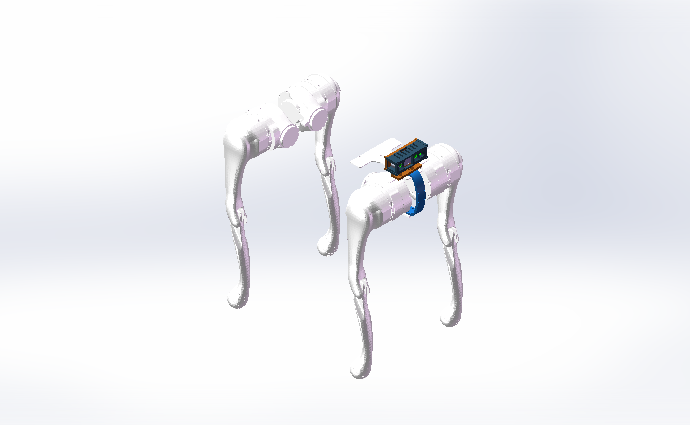

> 最新前盖开口已改为光学渐扩结构；本页外缘与厚度不变。见[前盖光学扩口说明](前盖光学扩口说明.md)。

# 当前前后盖外缘与厚度

以现有主壳为准修改前后盖，没有扩大或修改主壳。本次主壳SLDPRT文件SHA256与修改前一致。

主壳不是相机曲面的共形包覆，而是90×25mm矩形包络名义零间隙定位，圆角处保留局部空隙。主壳主体外缘为98×33mm矩形，四角因φ3孔座补强局部达到101×36mm。因此前后盖复制的是“矩形主体＋四角补强”的真实外缘，不用简单102×37mm的大矩形，也不切掉原孔座来追求简单矩形。底部等必要安装避让保持。

当前：前保护框厚6mm，位于相机机械Zc=0…6mm；内侧面不变，向前加厚4mm，机器人X=224.2…230.2mm。后盖属于支架后盖一体件，厚6mm，Zc=-31.05…-25.05mm，对应机器人X=193.15…199.15mm。中间主壳Zc=-25.05…0mm不变。三者外缘依据同一20顶点基准轮廓，详见验证JSON。

前盖：零件/相机/相机前保护框.SLDPRT。后盖：零件/连接件/相机支架与后盖一体件.SLDPRT。同名STEP、相机子装配及机器人总装已同步。默认中文特征名保留，辅助几何隐藏；旧独立后盖/旧支架不再使用。

后盖与支架原Z=106…107mm接缝已填实，竖板顶端延至108mm，仍是连续的6mm单实体。所有φ3孔心与轴向保持；相机机械原点(224.2,-17.5,100)mm、深度光学原点(220,0,100)mm不变。

前后盖各6mm与主壳25.05mm的贯穿名义叠厚合计37.05mm。此前螺钉长度不能直接沿用，必须再计垫圈、螺母及所需露牙；未指定实际螺钉型号。底座先固定，再安装相机。主壳四孔仍为φ3，未做内螺纹。

已验证两件为有效单实体、后盖接缝空缺体积0、更新件与相机及其他精确CAD零件无实体交叠。前盖的精确截面与预期轮廓布尔差为0。没有执行完整光学射线追踪；6mm前盖下的完整视场、实物公差、强度和紧固件/工具空间仍未验证，不能把“CAD无交叠”等同于“光学无遮挡”。

当前总装25组件、顶层22组件，相机子装配只有相机、主壳、前框3组件；后侧保护由总装的一体支架提供。

