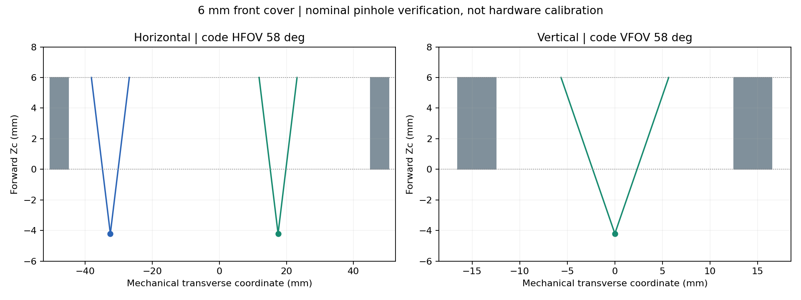

> 历史方案：本报告对应此前90×25mm矩形开口，不代表当前前盖。当前结果见[前盖光学扩口说明](前盖光学扩口说明.md)。

# 6mm前盖与wmp_go2深度视场验证

结论：**按代码要求58°×58°，当前6mm前盖在名义针孔CAD模型下不遮挡左右红外视场。** 未修改任何CAD或代码；相机位置按用户安装保持，不评价代码中的位置字段。

## 代码要求

Go2AMPCfg.depth继承A1AMPCfg.depth；Go2只覆盖位置及俯仰范围等字段，horizontal_fov=58°、original=resized=(64,64)仍沿用父类。warp_cam.py用水平视场与H/W计算垂直视场，64/64对应垂直58°。legged_robot.py的裁剪调用当前被注释，不能以裁剪后的更小视场作为遮挡通过依据。play.py的75°是录屏相机，不能用于本深度传感器判断。具体文件与行号见FOV代码依据.md。

## 当前几何和计算

直接读取最终`交换模型/STEP/相机前保护框.step`，确认前盖机械Zc=0…6mm。开口90×25mm，范围Xc=±45、Yc=±12.5mm。项目采用左红外光心(17.5,0,-4.2)mm；为避免只看单目，再检查右红外名义中心(-32.5,0,-4.2)mm（50mm名义基线）。坐标均是相机机械系，不是机器人系。

后盖接触相机不产生额外后移：后盖此前是向外加厚，原相机安装面和姿态未变。光心到前盖最外沿距离=4.2+6=10.2mm，计算已计入。

视场半角29°，外沿半宽/半高=10.2×tan(29°)=5.653952mm。

| 检查 | 前盖最外沿射线范围（机械mm） | 到开口最小余量 |
|---|---|---|
| 左红外水平 | X=11.846048…23.153952 | 水平21.846048mm |
| 右红外水平 | X=-38.153952…-26.846048 | 水平6.846048mm |
| 两个红外垂直 | Y=-5.653952…5.653952 | 垂直6.846048mm |

左右各用65×65网格，包括视场边界，合计8450条射线；使用OpenCascade对实际前盖实体做射线—面相交检查，0条命中。所有边界射线均位于矩形开口内，最外沿余量最小约6.85mm；结合直线开口和视锥单调扩张，名义连续针孔视锥也在开口内。网格不是实机逐像素标定结果。

另作87°×58°宽视场敏感性试算：左右各4225条射线，同样0命中，最小余量约2.82mm。87°只作为额外试算，不宣称它是用户实际硬件流的标定值。

## 适用范围和实机复核

- 以上是名义针孔模型，不包括有限入口瞳、镜头畸变、装配偏差和制造公差；未验证RGB相机及红外投影器完整光场。
- 代码的相机姿态随机化不应额外叠加成镜头相对前盖的转角；实体相机与外壳一起安装，其相对几何固定。若镜头实际相对前盖倾斜，应重新测量和计算。
- 压缩包中没有找到pyrealsense采集、流内参读取或实际设备enable_stream实现，不能确认硬件输入已正确形成58°×58°。将宽画面直接缩放成64×64不等于获得58°×58°，需按实际内参和裁剪区域处理。
- 实机应在同一流配置下对比裸相机和装壳后的原始左右红外图、深度有效像素和四角边缘，再对远近平面做检查；裁剪与后处理可能掩盖遮挡，不能只看最终64×64图。

因此，**就这份代码规定的视场，当前6mm前盖无需因名义几何遮挡而削薄或扩大开口；实机成像仍为NOT VERIFIED。**

数值与模型/压缩包SHA256见前盖FOV验证.json。CAD和代码均未修改。

