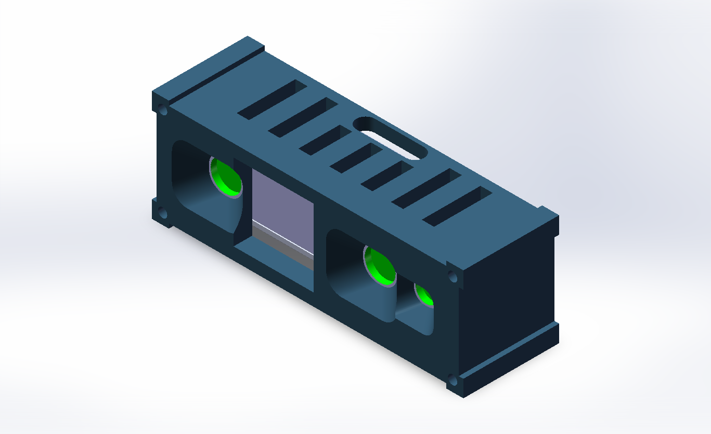
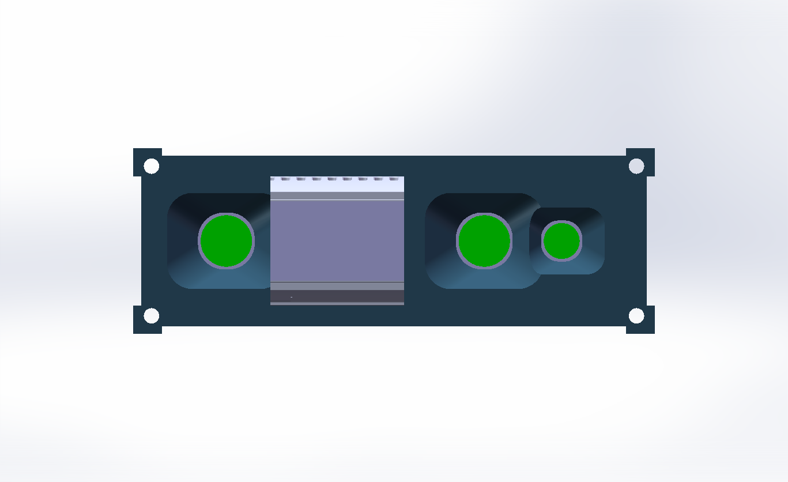

# 前盖光学扩口与防脱设计

本文件描述当前最终前盖，替代此前90×25mm大矩形开口方案。文件：`零件/相机/相机前保护框.SLDPRT`、`交换模型/STEP/相机前保护框.step`。相机装配和机器人总装均已同步。

## 几何与可编辑步骤

外缘继续与主壳同轮廓，包围盒101×36×6mm；相机机械坐标Z=0…6mm。四角安装孔直径3mm、圆心X=±47mm、Y=±14.5mm，不改变主壳、相机、后盖或安装变换。

原来的大矩形开口改为三个渐扩光学开口和中间预留开口。两个红外窗口直径10mm，圆心(-32.5,0,0)、(17.5,0,0)mm；RGB窗口直径7mm，圆心(32.5,0,0)mm。实测窗口外沿再留0.5mm侧向余量。内端红外开口为11×11mm、角半径5mm；RGB为8×8mm、角半径3.5mm。这样完整容纳圆形窗口，不将保护件压入窗口。

开口朝远离相机方向扩大：红外按水平90°、垂直65°设计，RGB按72°×45°设计。每个截面的外形为“圆形窗口＋矩形余量”，平直放样贯穿6mm厚度，覆盖整个窗口面出射的方向范围；相邻扩口外端允许相交，以避免留下遮光隔墙。为避免面重合，放样截面在Z=-0.01和6.01mm，后一个截面按6.01mm计算扩张。相机前表面保持Z=0，不移动相机。

中央X=-24…2、Y=-12.5…12.5mm保留26×25mm直通开口，对应胶布遮挡区域。用户尚未确认投射器是否停用，因此不把该区域填满；该开口不是经过实测确认的投射器最终窗口。

工程树保留SolidWorks默认中文名称：凸台-拉伸1（6mm板），切除-拉伸1（四个φ3孔），切除-放样1/2/3（三个扩口），切除-拉伸2（中央预留开口）。辅助基准面与草图隐藏。尺寸可通过编辑相应草图和特征修改，未使用导入实体冒充建模步骤。

## 验证

- 原生文件重开：单一有效实体，特征无错误。STEP在SolidWorks和独立CAD内核中可读为单一有效实体。
- 精确极值与独立包围盒：101×36×6mm。普通SW近似包围盒可能高估放样曲面的边界，不用它判断厚度。
- 四个安装孔均为φ3mm，位置不变。
- 与相机及主壳的公共体积均为0mm³；仅名义接触面重合，不代表验证了制造公差。
- 原边框材料全部保留，新增约6129.79mm³防脱覆盖体积，约为原边框体积的101%。不是强度或跌落认证。
- SolidWorks直接对原生前盖执行五组光线检测：两红外90°×65°、RGB72°×45°、两红外代码要求58°×58°。每组33个窗口面起点×17×17方向=9537条，共47685条；全部0次前盖相交。起点包括32个圆周点及圆心，额外实体对照光线产生2次相交，确认检测工作。检测为有限采样，不宣称覆盖所有实际误差。
- 原生与STEP曲面分别取54和58个样本、双向最近点比较，最大差约1.85e-14mm；STEP增加的面数属于分面结果。此检查不是全局最大误差证明。
- 体积积分估计：SW原生高精度12206.16797mm³，SW读回STEP高精度12206.24035mm³，独立内核STEP12206.14770mm³。估计值最大差约0.093mm³（约0.00076%），曲面采样位置一致；记录该数值差异，不把有限采样当作数学上完全相等的证明。装配使用原生SLDPRT。
- 机器人总装25组件全部引用本项目文件，替换前后所有组件的完整变换矩阵一致，深度图名义光学原点仍为机器人(220,0,100)mm。

## 使用边界

视场参数参考[RealSense D400 Series Datasheet March 2026](https://www.realsenseai.com/wp-content/uploads/2026/03/RealSense-D400-Series-Datasheet-Mar-2026.pdf)，本设计以红外87×62°包络及RGB69×42°名义规格为基础增加3°角度余量。代码58×58°依据仍见[FOV代码依据](FOV代码依据.md)。角度余量不能替代实机标定、镜头偏心、安装倾斜和打印误差检查。

中央投射器完整视场：**NOT VERIFIED**。实机四路成像、投射器、打印装配公差及防脱强度：**NOT VERIFIED**。当前是可编辑的CAD设计和名义几何验证，不宣称已完成实机全部视场验收。

绿色区域是相机模型中的窗口参考草图显示，不是新增材料。
