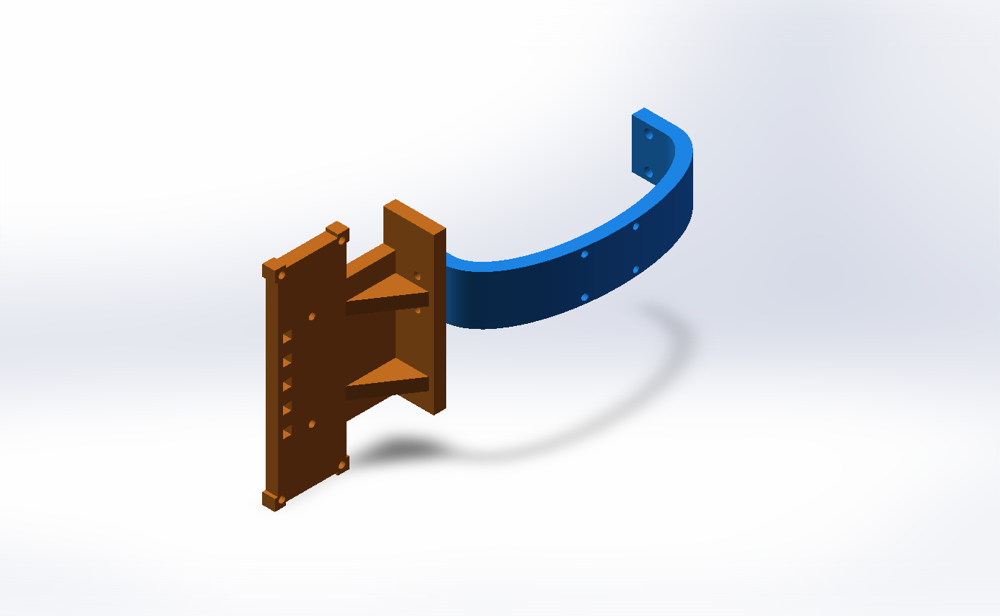
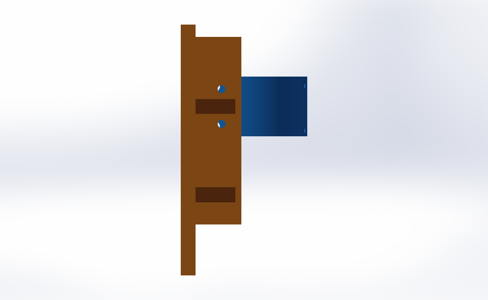

# 相机支架与中间连接件孔位对齐：当前记录

本记录替代此前将“凸台圆柱”误记为“通孔”的中间结果。已移除错误新增的两根φ3.2实体柱，直接编辑原有“切除-拉伸4”的草图，将原两孔Y=±20mm移到Y=±7mm；没有在旧孔之外再叠加一对孔。旧±20位置在基板厚度范围内已恢复实体。

## 当前两孔

| 项目 | 相机支架与后盖一体件 | 圆弧中间连接件（紧凑方案） |
|---|---|---|
| 孔径 | φ3.2mm真实通孔 | φ3.2mm真实通孔 |
| 机器人X | 209.578586630296mm | 209.578586630000mm |
| 机器人Y | -7、+7mm | -7、+7mm |
| 孔轴 | 机器人Z方向 | 机器人Z方向 |
| 孔距 | 14mm | 14mm |
| 零件安装面厚度带 | Z=53.656…59.656mm | 上端Z=47.656…53.656mm |

孔轴CAD偏差约3e-10mm，按1e-6mm阈值通过。两件在Z=53.656mm处名义贴合，实际螺钉长度、螺母及制造公差尚未选型。相机本体及光学坐标未改变。

## 验证

原生模型单一有效实体、重建无特征错误。STEP重新读取并识别为内孔壁，不仅是看见圆柱面：在两孔轴线上取点检查为空，在半径2mm的周围取点检查仍有实体；原Y=±20、Z=57mm的旧孔轴位置现为实体。相机支架与新中间件的实体公共体积为0mm³。数据见“相机与中间件孔位对齐验证.json”。

此前记录的Z=49.656…69.656mm并非正确通孔范围，已废止；新增柱移除后，基板恢复原厚度和外形，没有把支架向下加长。工程步骤保持原默认中文名称。

## 同步文件

- `零件/连接件/相机支架与后盖一体件.SLDPRT`及其交换STEP：真实通孔移位，旧孔不再保留。
- `零件/连接件/圆弧中间连接件.SLDPRT`、同目录生成STEP、`交换模型/STEP/圆弧中间连接件.step`：采用已验证的紧凑版本，与运动包络目录中的“紧凑避让”模型一致。
- `装配体/无头Go2传感器安装总装.SLDASM`：已引用新中间件并用单位变换定位；不能再套用旧267.060mm平移/-90°旋转。
- `运动包络/圆弧连接件避让方案/无头Go2_紧凑圆弧避让验证.SLDASM`：已同步正式零件，附安全参考包络。
- 相机子装配、全部组件两份坐标CSV、关键相对坐标、完整变换JSON、孔坐标和孔配对CSV、模型清单和截图同步更新。
- 正式装配记录25个实例，其中24个启用；旧雷达转接件不适配新曲壁，已抑制，待对应重设计。验证副本额外包含1个安全参考实例。

这不代表全机已通过动态干涉：雷达延长板仍待前部收窄及孔位配套，下方支撑件仍为原件；本次完成的是相机支架与新中间件的真实通孔和装配引用对齐。

排查用临时源码、中间态模型和错误结果截图移出项目，保留在系统临时目录 CameraAlignmentDiagnosticsArchive；原中间件旧版另备份于 AlignedCameraAssemblyBackup。原始下载资源不属于本次编辑范围。

附加空间检查：使用虚拟直径5.5×高3mm头部、直径6.35×高20mm工具、下方直径6.35×高2.4mm螺母外包络，分别在两孔检查，对相机支架和中间件均无实体重叠。这是指定外包络检查，尚未选定真实紧固件，不沿用此前直径12mm套筒通道的结论。

后续加强筋微调：中央筋改为Y=-3…3mm，工具包络两侧间距均约0.825mm；孔径、孔距、孔轴及相机位置不变。见相机连接支架加强筋说明.md。
