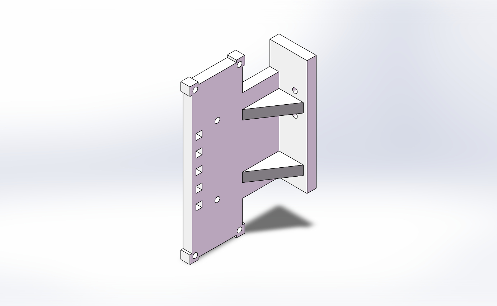

> 后续已让后盖上部板面随原主壳外缘，不再外扩；前盖厚度6mm。见[当前轮廓说明](前后盖外缘与厚度说明.md)。

# 相机支架与后盖一体化（当前版本）

最终零件：零件/连接件/相机支架与后盖一体件.SLDPRT；同名STEP位于交换模型/STEP。单一原生实体，保留中文默认特征、加强筋和全部孔位。原独立支架与后盖已从装配和项目中移除。

后盖从3mm向机器人后方加厚至6mm，内面X=199.15保持，外面为X=193.15，与支架竖板共面同厚。将支架竖板顶端从Z=106延伸至108mm，填实Z=106…107mm原接缝，与后盖连续融合；不是保留两件接触装配。验证该接缝区域空缺体积为0。

相机没有移动：机械原点(224.2,-17.5,100)mm，深度光学原点(220,0,100)mm=(22,0,10)cm。其他24组件位置与旋转不变。总装顶层仍22组件；相机子装配移除后盖后仅3组件，总数由26变25。相机子装配单独打开不包含后侧保护，完整保护由总装中的一体支架提供。

一体件按机器人坐标绘制，以单位变换安装。原底部孔、相机后孔及后盖四孔轴位和φ3孔径不变。后盖外面四孔端点为X=193.15、Y=29.5或-64.5、Z=85.5或114.5mm，轴平行X。后盖贯穿厚度增加3mm，需重新按实物螺钉和螺母选择长度，不能直接沿用旧长度。先固定底座，再装相机与其余保护壳。

已确认有效单实体、接缝填实、与其他已装配精确CAD组件无实体交叠；未完成材料强度、整机动态、缺失base机身、实物公差和工具/螺母完整校核。

此前文档中的独立后盖、3mm后盖或26组件描述为历史范围，以当前变换JSON、CSV和本说明为准。

