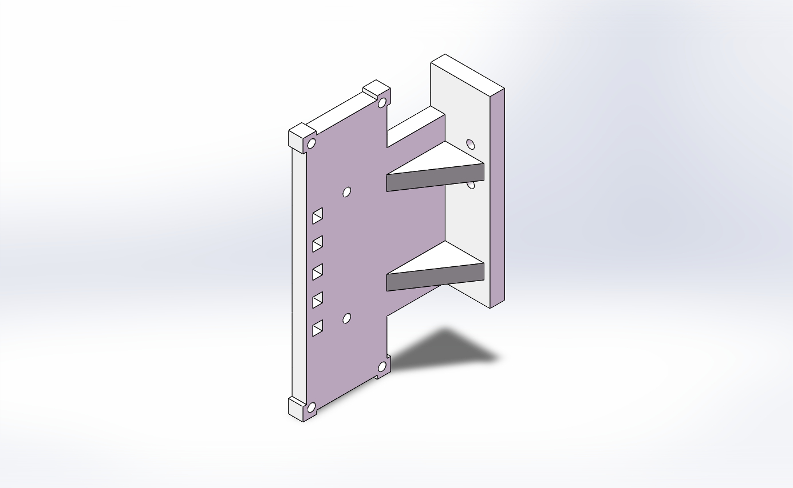
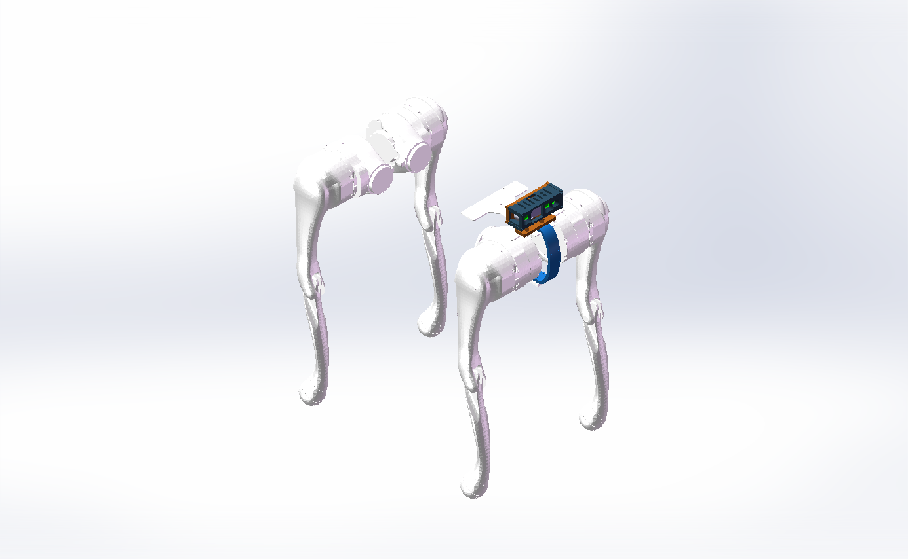

# 相机支架加强筋：当前布置

对象是当前“相机支架与后盖一体件.SLDPRT”，对应相机支架与紧凑中间件两孔φ3.2、孔距14mm的方案。本页替代旧独立相机连接支架、±20mm底孔和直径12mm工具通道的历史说明。

## 本次调整

靠近两个新孔的中央加强筋，沿机器人Y负方向移动0.5mm：原Y=-2.5…3.5mm改为Y=-3…3mm，中心对准两孔之间的Y=0。远侧加强筋仍为Y=-38.5…-32.5mm。两个孔仍为Y=±7mm、X=209.5785866303mm，φ3.2，孔距14mm；相机、后盖、底板、圆弧件和装配坐标不变。

两片筋仍各厚6mm，三角截面水平边16mm、竖直边24mm，顶点为(199.15,Y,59.6560709105)、(215.15,Y,59.6560709105)、(199.15,Y,83.6560709105)mm。未删除加强筋或减小筋截面。编辑的是原加强筋参考草图的3个定位点，不叠加新凸台或导入实体，原生默认中文特征名称保留，辅助参考几何隐藏。

## 调整原因与验证

新孔位下，原布局对φ6.35mm虚拟直线工具包络的两侧最小CAD间距约为1.325mm和0.325mm，偏向一侧。居中后两侧均约0.825mm，最紧一侧增加0.5mm。该数值不是旧直径12mm套筒通道结论；未宣称12mm套筒可用。

当前验证：指定φ5.5×高3mm头部包络、φ6.35×高20mm工具包络、下方φ6.35×高2.4mm螺母包络，在两个孔处与相机支架和中间件的实体公共体积均为0。两孔轴内部为空、孔周围仍为实体，旧±20孔保持已填回状态。相机支架与中间件公共体积仍为0，孔轴及孔径未改变。原生模型和STEP为有效单实体，原生重建无错误。

上述包络是用于检查的指定几何尺寸，不等于已经选择具体紧固件或工具。安装顺序仍建议先固定支架与中间件，再安装相机和保护壳；装好相机后是否能无拆卸维修，尚未验证。

已同步SLDPRT、交换STEP、正式总装、紧凑方案验证副本、截图和文件哈希。详细安装包络数据见“相机与中间件孔位对齐验证.json”，本次修订数据见“加强筋居中调整验证.json”。

材料、实际载荷、打印方向、冲击和疲劳强度未进行分析，本次是安装避让改进，不作额定承载承诺。

