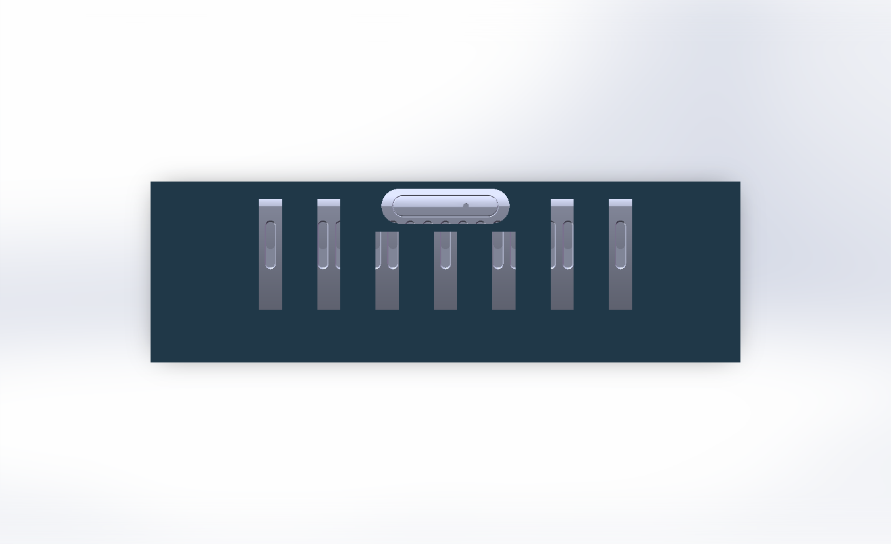
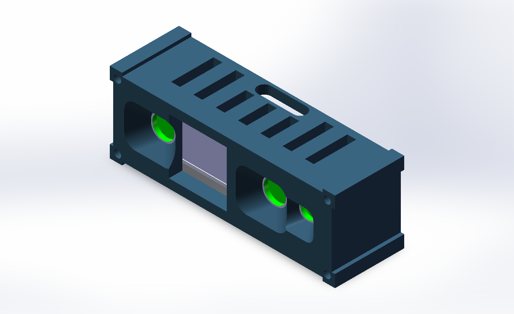

> 一体化更新：独立后盖/支架已停用，当前为6mm无缝一体件；相关旧尺寸和组件数量见[当前一体化说明](支架后盖一体化说明.md)，实际定位以当前CSV/JSON为准。

# 相机顶部长条接口开窗

根据用户实物照片确认，需要露出顶部散热槽旁的长条接口区域及两端位置；本次不是扩大相机与壳体间隙，而是在保护壳壁上开贯穿窗口。接口类别及电气用途不在此推定。

## 最终修改

- 更新零件：`零件/相机/相机保护主壳.SLDPRT`，原路径替换，未保留旧版在项目中。
- 开窗：长圆形，整体长22mm、宽6mm、两端R3mm；两端圆心间距16mm。
- 相机机械局部坐标：窗口中心取内壁面(0,12.5,-20.82)mm；轴沿局部+Y贯穿4mm壁厚。
- 窗口长向沿局部X，窄向沿局部Z，包络Xc=-11…11、Zc=-23.82…-17.82mm。
- 对应机器人系内壁面中心：(203.38,-17.5,112.5)mm。长向沿机器人Y，窄向沿机器人X，贯穿机器人Z=112.5…116.5mm。
- 相邻三个顶部散热槽（机械局部X=-10、0、10mm）缩短为Zc=-16.5…-3mm，与长圆窗口留1.32mm连接筋，其他散热槽不变。
- 原连接孔、前框、后盖及相机连接支架不改；开窗不延伸到前后盖，因此无需改变其几何。

该轮廓由现有CAD中长条区域定位，照片用于确认形状，没有按照片像素比例推算尺寸。模型接口名义包络约Xc=±9.05、Zc=-22.62…-19.02mm，已被窗口覆盖。实际插头、线缆护套及工具外形未提供，实物插拔和扳手空间仍为NOT VERIFIED，可按实际线材调整草图7。

## 工程步骤与同步文件

主壳在新文档内按原参数重建：保留SW默认中文名，`凸台-拉伸1…5`及`切除-拉伸1…6`（后续四角孔座加厚增加4个凸台）。`切除-拉伸3`为调整后的顶部散热槽，`切除-拉伸6`为长圆接口窗。编辑其草图7可调整窗口；草图未全面尺寸约束。基准面、3D草图及普通草图隐藏。

同名STEP、带保护壳的深度相机子装配、无头Go2传感器安装总装均已同步保存。全部26个组件位姿和原安装孔不变，深度图光学原点仍为(220,0,100)mm，即(22,0,10)cm；安装坐标表不需要改变。

## 验证

有效单实体；新几何与“缩短3个散热槽＋切除长圆窗口”的预期布尔模型双向差体积为0。名义接口包络上方通道被壳体遮挡的体积为0，主壳与相机、前框、后盖的交叠体积为0。窗口边缘和余下连接筋未做强度或制造验证，数据见顶部接口开窗验证.json。

后续相机保护壳连接孔已统一为φ3并补厚四角孔座，顶部接口窗口不变，见[连接孔径统一说明](连接孔径统一说明.md)。
