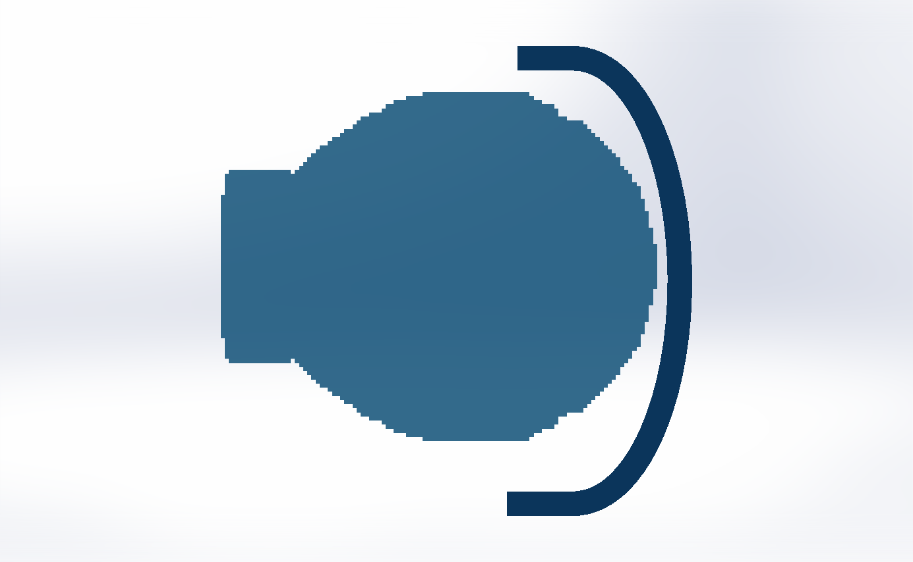
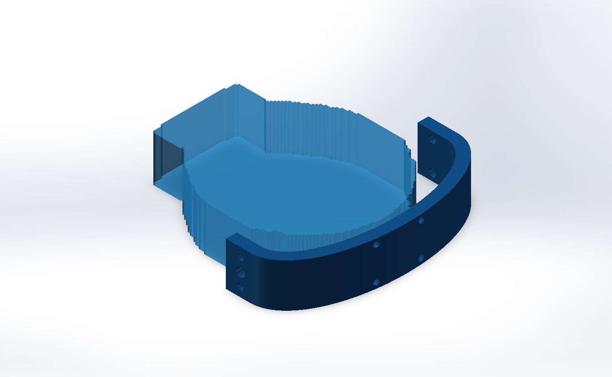
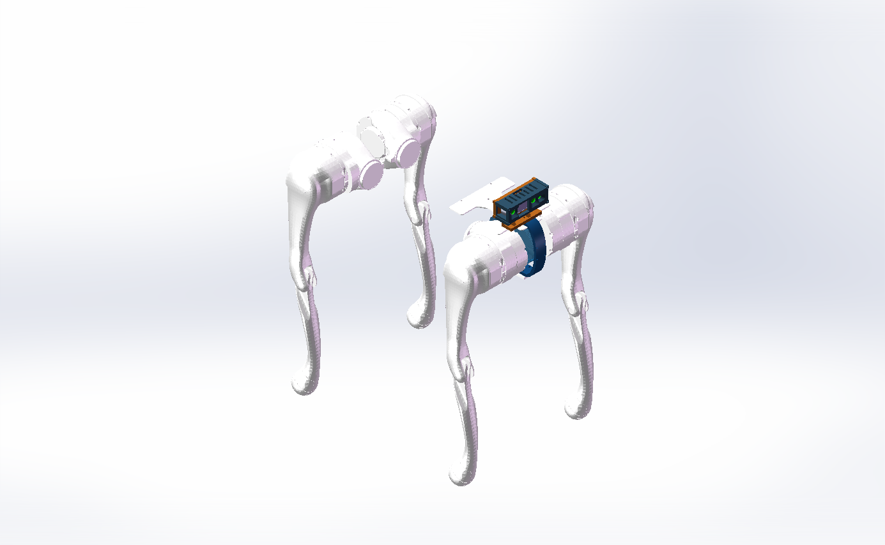

> 完整侧向复核：当前24mm宽的全局参考间距约1.73mm；本页2.14mm等数值仅为局部侧面参考距离。若要求安全参考体之外再留2mm，等宽上限约23mm、建议22mm，尚未改模。见[完整三维间隙说明](等宽上限与完整三维间隙说明.md)。

> 最新同步：正式圆弧件已采用本方案；相机支架孔位已对齐。以[孔位对齐记录](../../说明资料/孔位对齐变更记录.md)为准。

# 当前紧凑圆弧连接件及安装验证

本页是当前最新方案。打开“无头Go2_紧凑圆弧避让验证.SLDASM”查看验证装配，独立编辑“紧凑避让_圆弧连接件.SLDPRT”。此前“避让扫掠_圆弧连接件”半圆试案不是本次结果。

## 设计

上下安装高度保持原件：上平面机器人Z=47.65607091…53.65607091mm，下平面Z=-60.71850667…-54.71850667mm。两端平面厚度6mm；中段及上端宽24mm，下端宽24mm。下端孔的原有位置保持。

采用扁圆弧形截面（类椭圆），内侧由两段三次曲线平滑连接，端部切线与上下平面一致。截面中心X=215、Z=-3.53121788mm，内侧半轴X=23、Z=51.18728879mm。外侧由内侧6mm等距曲线逼近生成，曲线逼近最大误差约0.00000952mm；是名义6mm等厚设计，不是上一试算中局部加厚到8mm的外椭圆。零件最前端X=244mm，比前一半圆试案X≈272.187mm减少约28.19mm。

默认中文工程树：凸台-拉伸1（曲壁）、凸台-拉伸2/3（上下平面）、切除-拉伸1/2/3（上端、下端及雷达接口孔）。辅助基准面、草图隐藏；不是导入实体冒充原生步骤。草图可编辑，但没有全部参数尺寸约束，曲壁外侧不会在修改内侧后自动重算等距轮廓，后续修改需同步。

上端孔位按用户已解除的约束重布：两个φ3.2孔Y=±7mm、X=209.57858663mm；中央φ5孔保留。下端两个φ4孔X=206.922944746、Y=±8mm，原安装高度保持。中部预留4个φ3孔，轴向X，Y=±9、Z=±12mm，供后续新雷达转接件使用。

## 验证方法

不对原先局部非流形STL包络直接进行实体布尔。读取原始±48°/±60°采样占据数据，各自先向外扩张3mm作为参考容差，再在零件宽度覆盖区域Y=-12.5…12.5mm内进行侧向保守投影并填满投影内空洞，转为可验证的精确阶梯状CAD实体。这个投影包络会包含该宽度区域的占据数据，不能理解为整机所有Y截面的完整外形。

3mm是为离散近似增加的设计参考量，尚未建立对源模型、实机、连续角度及动态变形误差的严格总上界。原始包络仍为1°、1mm离散数据。以下PASS仅相对于本安全参考实体，不是实机连续运动认证。

独立CAD内核实体求交与最小距离（mm）：

| 范围 | 上部Z>40 | 中间-40≤Z≤40 | 下部Z<-40 | 整体公共体积 |
|---|---:|---:|---:|---:|
| ±60°，已扩大3mm | 5.156 | 2.136 | 12.219 | 0mm³ |
| ±48°，已扩大3mm | 5.156 | 2.729 | 12.219 | 0mm³ |

SLDPRT为单一有效实体，重建无特征错误；STEP独立读取有效。两个安全参考STEP也可读为CAD实体。详见“紧凑圆弧实体干涉验证.json”和“紧凑圆弧实体干涉验证_48度.json”。

## 装配验证

已在机器人装配副本中抑制原圆弧中间件及旧雷达转接件，添加本件和±60°安全验证实体。新件和参考实体均已使用机器人基坐标造型，插入变换为单位阵，不能再叠加原圆弧零件的局部变换。检查了真实组件变换及包围盒：新件X=198.922944746…244、Y=±12、Z=-60.718506671…53.656070911mm；安全参考X=129.5…235.5、Y=±12.5、Z=±42.5mm。23个其余原组件的变换与正式总装一致，相机光学位置不动。

正式总装已换用紧凑中间件，相机支架两孔已同步为φ3.2、Y=±7并验证同轴。此副本仍不是完整紧固连接验收：雷达延长板孔位及前端宽度尚需配套；雷达延长板原件此前已发现与包络干涉，尚未按26mm方案修改；旧雷达转接件不适合新曲壁，已在验证副本抑制。没有把这些未改零件判定为整机无干涉。

后续更改曲壁、端部宽度或安装坐标，必须重新运行包络检查。紧固件、完整腿部姿态、强度、制造公差及实机动态检验为NOT VERIFIED。

