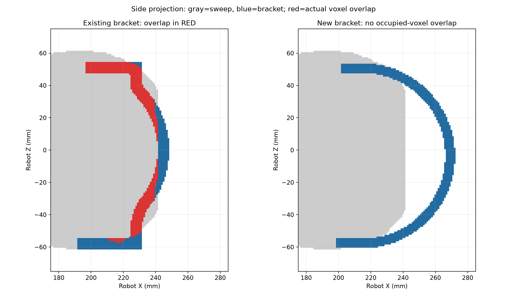
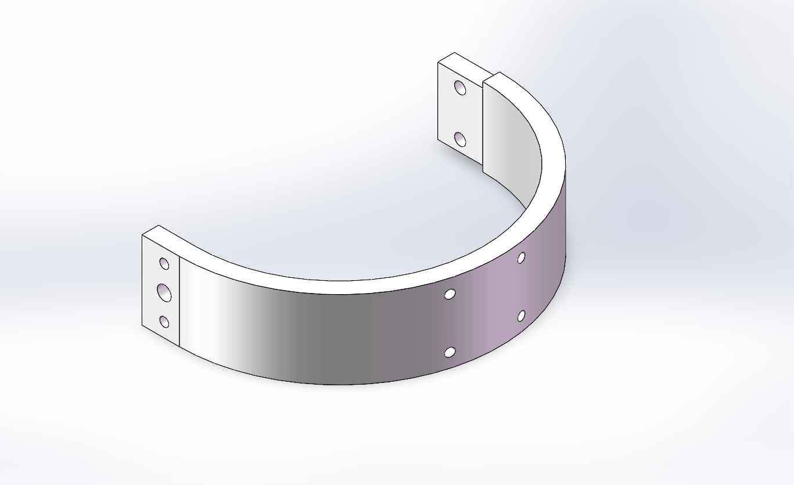

> 此页为早期半圆试案。当前结果见[当前紧凑方案说明](当前紧凑方案说明.md)。

# 圆弧连接件：干涉量测与避让方案

当前方案在此目录独立保存，未替换机器人总装，也未替换项目最终零件。此前上安装面提高7mm的试案已取消，当前上下安装面高度均恢复原件高度；上端孔位按用户最新指示不再作为保留约束。

## 原件量测（基于现有1mm离散包络）

原件整体重叠约17433mm³。按Z>40mm、Z<-40mm及中间分区，上段6085mm³、下段2454mm³、中段8894mm³。

单独考察上端6mm平面厚度带（网格中心Z=48…54mm）：最大侵入包络深度约8.60mm；保留该区域原宽度并整块向上平移，在1mm步长下约11mm首次不重叠。保持原高度居中裁窄，上端可保留约36mm宽度而不发生占据网格重叠，该临界宽度不含额外设计间隙。下端平面厚度带（Z=-61…-55mm）最大侵入约2.83mm，仅该平面区域向下约3mm首次不重叠；下段圆弧/直段仍需单独避让，不能由此说整个下段下移3mm即可。

以上侵入深度为落入包络内部的体素中心到最近空体素中心的最大距离，不是沿某一固定方向的精确实体穿透深度。平移扫描、裁窄扫描同样以1mm网格判定。结果见两个“原件…避让量测.json”。

## 当前新方案

- 6mm厚，单一半圆环加上下两个直平面，原生SolidWorks默认中文拉伸与切除特征。
- 圆弧中心机器人坐标(215,0,-3.53121788)mm，内半径51.18728879mm，外半径57.18728879mm，中段沿Y宽28mm。圆弧向机器人前方鼓出，最前约X=272.187mm。
- 上安装平面Z=47.65607091…53.65607091mm，高度保持原件；上端宽28mm，X=201.57858663…215mm。上端两φ3.2孔重新布置为Y=±9mm、X=209.57858663mm，中央φ5孔保留。原相机支架上两个孔不能直接匹配此新孔距，需后续配套重设计；相机现有装配和光学位置未动。
- 下安装平面Z=-60.71850667…-54.71850667mm，宽24mm；下方两φ4孔仍为X=206.92294475、Y=±8mm，原安装面和孔轴保留。
- 圆弧上预留4个φ3雷达转接连接孔，轴向机器人X，Y=±9、Z=±12mm。此为新接口，原雷达转接件不能直接套用；配套新转接件尚未完成，未将此方案作为总装可直接替换版本。

## 当前验证与限制

原生文件单一实体、特征无错误；导出的STEP独立读取为有效单一实体。对保守不扣除孔洞的新方案解析占据体与现有扫掠体素求交：重叠0。最小体素中心距离约3.74mm，位于上端；下端约8.94mm。该距离不是两精确曲面的全局最小距离，不应当承诺实机至少有3.74mm间隙。

现有扫掠包络按±60°、1°角度步长、1mm体素生成，并有平滑和局部非流形网格问题。连续运动最小间隙、制造误差、全腿姿态、强度、线缆、相机支架和雷达转接件的完整配套装配均为NOT VERIFIED。当前只能判定相对于现有离散包络无重叠，不能作为制造/实机不干涉的最终认证。

